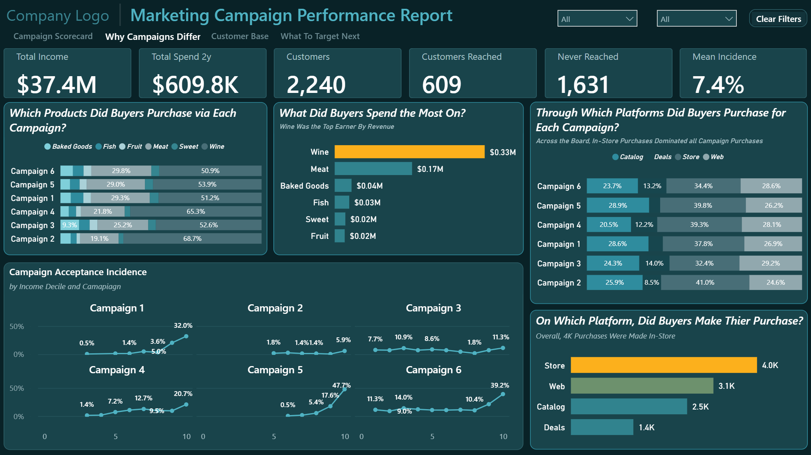

# 📈 Marketing Campaign Performance Report

### **Six campaigns. Different customer responses. Which customers should businesses target next?**

An interactive Power BI report exploring campaign acceptance, customer spending, and behavior to identify potential marketing opportunities.

`Power BI` · `DAX` · `Power Query` · `Marketing Analytics`

---

## 🧩 The Business Problem

**Which customers respond to marketing campaigns—and what can we learn from them?**

This report analyzes six campaigns to explore acceptance patterns, customer characteristics, and spending behavior.

**Built for:** Marketing managers · Campaign analysts · Customer insights teams · Business owners

---

## 📊 At a Glance

| Campaigns | Offers Recorded | Accepted Offers | Product Categories |
|---:|---:|---:|---:|
| **6** | **13,440** | **1,001** | **6** |

Campaign acceptance · Customer behavior · Spending patterns

Campaign pages use the page-level filter `Acceptance Indicator = 1`. Spending associated with campaign acceptors is not necessarily revenue generated by the campaigns.

---

## 🖼️ Explore the Report

### 1 · Campaign Scorecard — *How do campaigns compare?*

Compare campaign acceptance and spending associated with customers who accepted offers.

### 2 · Why Campaigns Differ — *What relates to customer responses?*

Explore customer characteristics and patterns associated with campaign acceptance.

### 3 · Customer Base — *Who are the customers?*

Explore customer characteristics and product-spending patterns.

### 4 · What to Target Next — *Which customers show potential?*

Investigate previous acceptance behavior to identify potential audiences for future campaigns.

---

## 💡 Insights & Recommendations

| Insight | Evidence | Recommendation |
|---|---|---|
| **Previous acceptance matters** | Campaign 6 acceptance was approximately 8.2% among customers with no previous acceptances versus 90.9% among those with four. | Test acceptance history as a targeting signal. |
| **Customer composition matters** | Campaign 5's observed spending ratio fell from 3.07× to 1.23× after income matching. | Compare similar customer groups before drawing conclusions. |
| **Small samples require caution** | Campaign 2 had only 30 acceptors in the audited analysis. | Validate results before reallocating resources. |
| **Spending is not incremental revenue** | The report measures customer spending, not proven campaign-generated revenue. | Track campaign costs and attributable outcomes to assess ROI. |

**Management takeaway:** Use customer behavior to develop targeting hypotheses, then validate them through controlled testing.

---

## ⚠️ Limitations

- **Campaign economics:** Campaign costs and incremental outcomes are not established.
- **Causation:** Observed associations do not prove cause and effect.
- **Small samples:** Results from campaigns with few acceptors require caution.
- **Customer composition:** Differences between customer groups can affect spending comparisons.

---

## ✅ Data Validation

| Validation item | Result |
|---|---|
| Spending measure | Sum of six product-category spending fields |
| Blank values | Replaced with zero using `COALESCE` |
| Campaign page filter | `Acceptance Indicator = 1` |
| Spending interpretation | Customer spending within the applicable filter context |
| Campaign revenue attribution | Not established by the spending measure alone |

---

## 🚀 How to Use

**Read it** — review the four screenshots above.

**Open it** — download the report from [`Power BI/`](Power%20BI/) and open it in Power BI Desktop. Update the data source path if necessary.

**Understand it** — explore the report's campaign comparisons, customer behavior, and targeting insights.

---

## 📁 Repository Structure

| Resource | Contents |
|---|---|
| [`powerbi/`](Power%20BI/) | Power BI report files |
| [`Dataset/`](Dataset/) | Source dataset, if approved for public distribution |
| [`images/`](images/) | Report screenshots |
| [`Marketing_Campaign_Performance_Report.pdf`](Marketing_Campaign_Performance_Report.pdf) | PDF report |

---

## 🛠️ Built With

- Microsoft Power BI Desktop
- DAX
- Power Query
- Microsoft Excel
- GitHub

---

## 👤 Author

**Yisak Fikre** — Microsoft Certified Data Analyst · Power BI Developer

   

**More projects:**

- [Sales Analytics Report](https://github.com/yisakfikre/sales-analysis-report)
- [SaaS Growth & Unit Economics](https://github.com/yisakfikre/SaaS-Growth-and-Unit-Economics)
- [Gross Margin Bridge](https://github.com/yisakfikre/Gross-Margin-Bridge-Dashboard)

---

## 📜 Licence

**MIT** for code · **CC BY 4.0** for data and documentation. See [LICENSE](LICENSE). No font binary, icon set or third-party component is redistributed.
