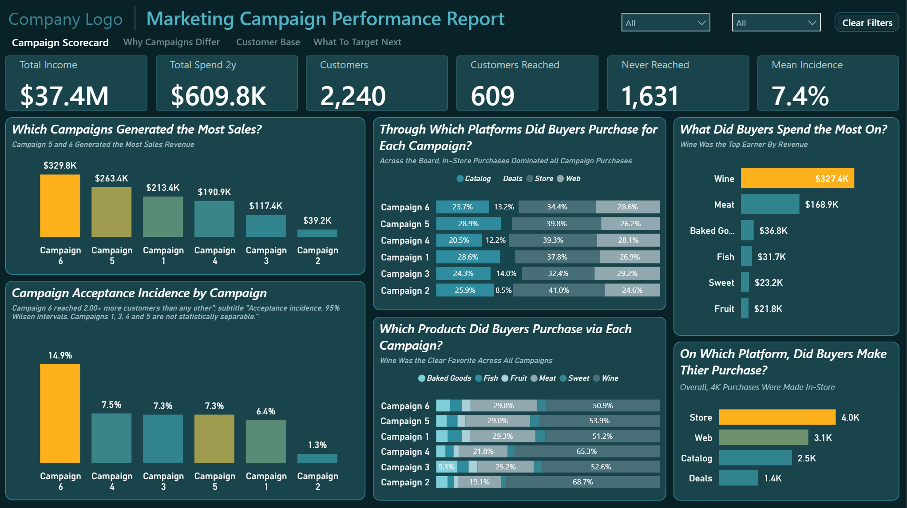
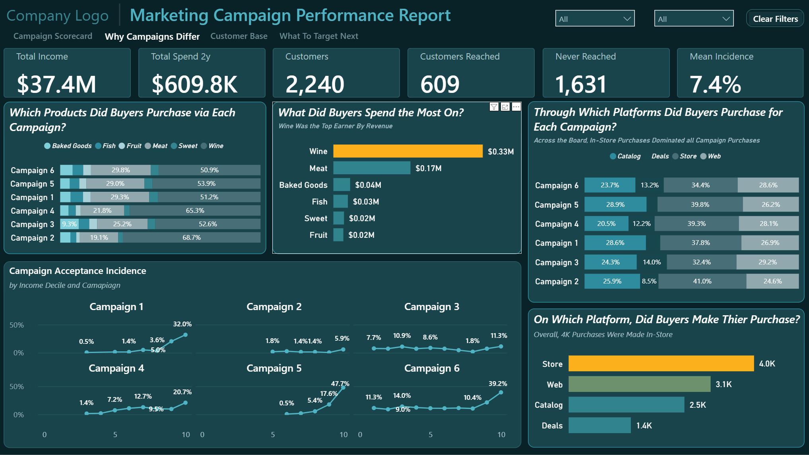
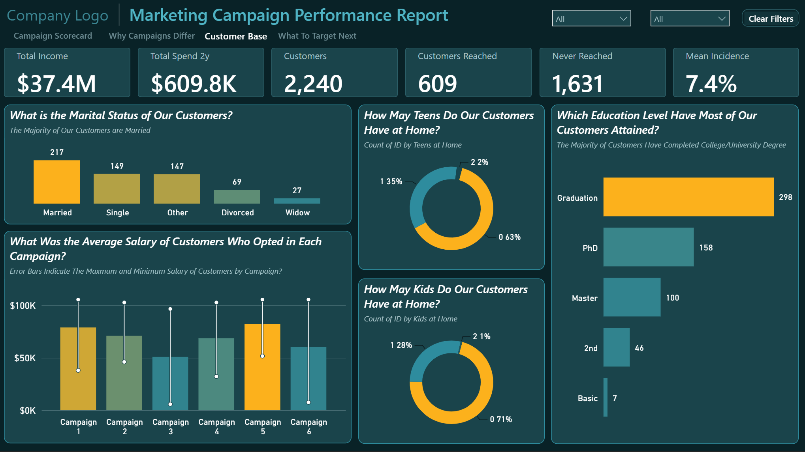
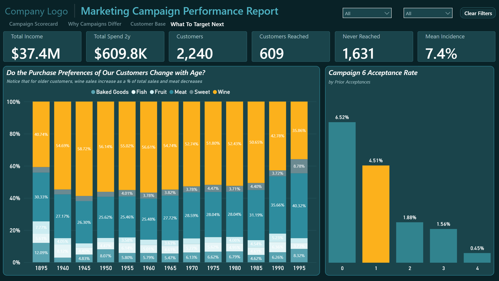

# 📈 Marketing Campaign Performance Report

### **Six campaigns. Different customer responses. Which customers should businesses target next?**

An interactive Power BI report investigating campaign acceptance, customer spending patterns, and customer characteristics to identify potential targeting opportunities and support more informed marketing decisions.

`Power BI` · `DAX` · `Power Query` · `Marketing Analytics`

---

## 🧩 The Business Problem

**Campaign acceptance alone does not explain customer value or establish campaign effectiveness.**

Businesses need to understand which customers accept marketing offers, how response patterns differ across campaigns, and how customer characteristics relate to acceptance and spending. Without considering customer composition, filter context, and attribution limitations, campaign comparisons can lead to misleading conclusions.

This report helps decision-makers explore:

- How acceptance patterns differ across six marketing campaigns.
- Which customer characteristics are associated with campaign acceptance.
- How spending patterns differ among customers who accepted campaigns.
- How previous campaign acceptance relates to subsequent responses.
- Which customer groups may warrant further investigation for future targeting.

**Built for:** Marketing managers · Campaign analysts · Customer insights teams · Business owners

---

## 📊 At a Glance

| Campaigns Analyzed | Offers Recorded | Accepted Offers | Product Categories |
|---:|---:|---:|---:|
| **6** | **13,440** | **1,001** | **6** |

Campaign acceptance · Customer characteristics · Two-year customer spending · Customer behavior

### Understanding customer spending

| Analytical measure | Interpretation |
|---|---|
| Total Spend 2y | Sum of spending across Wine, Fruit, Meat, Fish, Sweet, and Baked products |
| Campaign acceptance | Offers recorded as accepted |
| Customer spending by campaign | Spending associated with customers who accepted the respective campaign |
| Previous acceptance behavior | Relationship between prior campaign acceptance and subsequent responses |

The report's campaign pages use the page-level filter `Acceptance Indicator = 1`. Consequently, their results reflect the accepted-offer population unless a calculation explicitly overrides the filter.

Customer spending associated with campaign acceptors should not be interpreted as incremental revenue generated by the campaigns.

---

## 🖼️ Explore the Report

### 1 · Campaign Scorecard — *How do campaigns compare?*

Compare campaign acceptance patterns and spending associated with customers who accepted offers. Use the page to identify campaigns that warrant closer investigation rather than treating customer spending as proof of campaign-generated revenue.

### 2 · Why Campaigns Differ — *What is associated with customer responses?*

Explore differences in acceptance patterns and customer characteristics to investigate why responses vary across campaigns.

### 3 · Customer Base — *What characterizes the customer population?*

Explore customer characteristics and product-spending patterns to provide context for campaign comparisons and audience segmentation.

### 4 · What to Target Next — *Which customers may be promising candidates?*

Investigate previous acceptance behavior and customer characteristics to identify potential targeting opportunities for future campaign testing.

---

## 💡 Insights & Recommendations

The analysis highlights behavioral associations that may help guide future campaign testing. These findings should be interpreted within the report's filter context and the limitations of the available data.

| Insight | Evidence | Recommendation |
|---|---|---|
| **Previous acceptance is strongly associated with Campaign 6 acceptance** | In the audited analysis, acceptance was approximately 8.2% among customers with no previous campaign acceptances and 90.9% among customers with four previous acceptances. | Test previous acceptance history as a targeting feature and validate the results on a future campaign. |
| **Customer composition affects spending comparisons** | For Campaign 5, the apparent spending ratio decreased from 3.07× to 1.23× after income matching in the audited analysis. | Compare similar customer groups before attributing spending differences to campaign performance. |
| **Small samples limit campaign conclusions** | Campaign 2 had only 30 acceptors in the audited analysis. | Treat estimates from small groups cautiously and gather additional evidence before reallocating campaign resources. |
| **Acceptance does not establish incremental revenue** | The spending measure sums six product-category spending fields for customers in the relevant filter context. | Track campaign costs, delivery, timing, and attributable outcomes before evaluating incremental return on investment. |
| **Page-level filters affect interpretation** | All four pages use `Acceptance Indicator = 1`. | Validate acceptance rates using a denominator that includes accepted and non-accepted offers. |
| **Customer targeting requires further validation** | Customer characteristics and previous acceptance are associated with observed responses, but the analysis does not establish causation. | Use controlled campaign tests to evaluate whether targeting strategies improve future response rates. |

**Management takeaway:** Use customer acceptance history and customer characteristics to develop better targeting hypotheses, then validate those hypotheses through controlled testing. Evaluate incremental campaign outcomes rather than relying on customer spending alone.

---

## ⚠️ Limitations

- **Campaign economics:** Reliable campaign-level cost and incremental outcome data are required to establish profitability and return on investment.
- **Limited causal evidence:** Associations between customer characteristics, previous acceptance, and responses do not prove causation.
- **Small campaign samples:** Campaigns with relatively few acceptors require cautious interpretation.
- **Customer composition:** Differences in customer characteristics can influence spending comparisons and should be considered before drawing conclusions.

See [Known Limitations](KNOWN_LIMITATIONS.md) and [Data Validation](DATA_VALIDATION.md).

---

## ✅ Data Validation

The spending measure is defined as the sum of six product-category spending fields.

| Validation item | Result |
|---|---|
| Product categories included | Wine, Fruit, Meat, Fish, Sweet, and Baked products |
| Blank category values | Replaced with zero using `COALESCE` |
| Campaign page filter | `Acceptance Indicator = 1` |
| Spending interpretation | Customer spending associated with the applicable filter context |
| Campaign revenue attribution | Not established by the spending measure alone |

The unfiltered campaign-chart total and the accepted-population total represent different filter contexts. The difference should not be interpreted as a data error solely because the totals differ.

See [Data Validation](DATA_VALIDATION.md) for the supporting methodology and reconciliation details.

---

## 🚀 How to Use

**Read it** — the four screenshots above show the report's main views. No installation is required to review them.

**Open it** — download the Power BI report from the [`Power BI/`](Power%20BI/) folder and open it in Power BI Desktop. If the source file path has changed, update the data source and refresh the report.

**Understand it** — review the documentation for metric logic, data structure, analytical methodology, and implementation details.

**Explore the documentation:**

- [Project Overview](PROJECT_OVERVIEW.md)
- [Metric Definitions](METRIC_DEFINITIONS.md)
- [Data Dictionary](DATA_DICTIONARY.md)
- [Methodology](METHODOLOGY.md)
- [Data Validation](DATA_VALIDATION.md)
- [Known Limitations](KNOWN_LIMITATIONS.md)
- [Design System](DESIGN_SYSTEM.md)
- [Implementation SOP](IMPLEMENTATION_SOP.md)
- [GitHub Release Checklist](GITHUB_RELEASE_CHECKLIST.md)

---

## 📁 Repository Structure

| Resource | Contents |
|---|---|
| [`Power BI/`](Power%20BI/) | Power BI report files |
| [`Dataset/`](Dataset/) | Source dataset, if approved for public distribution |
| [`images/`](images/) | Report screenshots |
| [`Marketing_Campaign_Performance_Report.pdf`](Marketing_Campaign_Performance_Report.pdf) | PDF report |
| [`PROJECT_OVERVIEW.md`](PROJECT_OVERVIEW.md) | Business problem and scope |
| [`METRIC_DEFINITIONS.md`](METRIC_DEFINITIONS.md) | Metric definitions |
| [`DATA_DICTIONARY.md`](DATA_DICTIONARY.md) | Tables and columns |
| [`METHODOLOGY.md`](METHODOLOGY.md) | Analytical approach |
| [`DATA_VALIDATION.md`](DATA_VALIDATION.md) | Reconciliation evidence |
| [`KNOWN_LIMITATIONS.md`](KNOWN_LIMITATIONS.md) | Data and analytical limitations |
| [`DESIGN_SYSTEM.md`](DESIGN_SYSTEM.md) | Visual design standards |
| [`IMPLEMENTATION_SOP.md`](IMPLEMENTATION_SOP.md) | Build instructions |
| [`GITHUB_RELEASE_CHECKLIST.md`](GITHUB_RELEASE_CHECKLIST.md) | Release checklist |

---

## 🛠️ Built With

- Microsoft Power BI Desktop
- DAX
- Power Query
- Microsoft Excel
- GitHub

---

## 👤 Author

**Yisak Fikre** — Microsoft Certified Data Analyst · Power BI Developer

   

**More projects:**

- [Sales Analytics Report](https://github.com/yisakfikre/sales-analysis-report)
- [SaaS Growth & Unit Economics](https://github.com/yisakfikre/SaaS-Growth-and-Unit-Economics)
- [Gross Margin Bridge](https://github.com/yisakfikre/Gross-Margin-Bridge-Dashboard)

---

## 📜 Licence

**MIT** for code · **CC BY 4.0** for data and documentation. See [LICENSE](LICENSE). No font binary, icon set or third-party component is redistributed.
